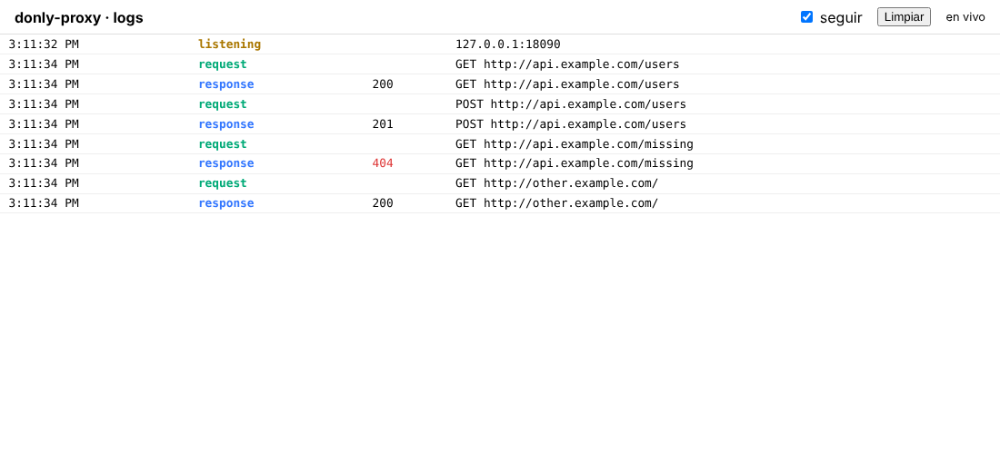
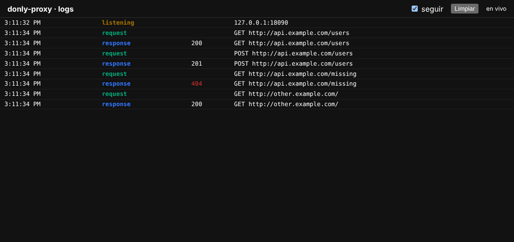
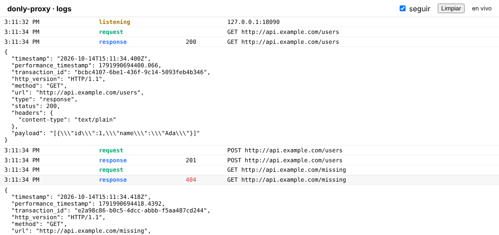

# donly-proxy

Proxy HTTP/HTTPS configurable con un manifiesto [DON](https://don.jon.soy/) (`manifest.donly`).
Por defecto responde `ok` a cualquier petición; con rutas (`route`) puede responder con un
cuerpo fijo, reenviar la petición a otro servidor (`proxy_pass`) o pasarla a `curl`, a un proceso `node`, a otra máquina por `ssh` o a un pod con `kubectl`
(`command_pass`). Cada transacción puede registrarse en un archivo `.ndjson`.

## Uso rápido

```sh
bun install
bun start                        # usa ./manifest.donly
bun src/cli/main.ts otro.donly     # usa otro manifiesto
bun src/cli/main.ts --ui           # además, página de logs en vivo en http://127.0.0.1:8081
bun src/cli/main.ts --ui --ui-port 9000   # la misma página en otro puerto
bun src/cli/main.ts --version      # imprime la versión (-V)
bun src/cli/main.ts --help         # muestra la ayuda (-h)
bun test
```

Con el servidor levantado (el `manifest.donly` de la raíz usa el puerto 8080; sin `port` se asigna uno libre y se imprime al arrancar):

```sh
curl -x http://127.0.0.1:8080 http://example.com/            # -> ok
curl -k -x http://127.0.0.1:8080 https://example.com/        # -> ok
```

### `--ui`: logs en vivo

`--ui` levanta, además del proxy, un servidor HTTP con una página que muestra el
[`log_file`](manifest.md#log_file) en tiempo real: al abrirla muestra las últimas 200 líneas y luego
las nuevas, que llegan por Server-Sent Events (`GET /events`). Pulsa una fila para ver el JSON
completo.

- Escucha **solo en `127.0.0.1`** (el log incluye cabeceras y cuerpos) y en el puerto `8081`, o el de
  `--ui-port <n>` (`0` = el que asigne el sistema). Es distinto del puerto del proxy.
- Requiere `log_file` en el manifest; sin él, el arranque falla con
  `--ui requiere log_file en el manifiesto para poder mostrar los logs`.
- No añade dependencias: la página va embebida como texto, también en el bundle de `dist/`.

Capturas (tema claro, tema oscuro y una fila expandida con su JSON):







## Cómo funciona

| Tráfico | Qué hace el proxy |
| --- | --- |
| HTTP | El cliente envía la petición con URL absoluta (`GET http://host/ruta`). El proxy la procesa directamente. |
| HTTPS | El cliente abre un túnel con `CONNECT host:443`. El proxy responde `200 Connection Established`, **termina el TLS él mismo** con su certificado y procesa la petición ya descifrada. |

Una vez que tiene la petición (con su URL completa, por ejemplo `https://example.com/ruta`), el
proxy:

1. Lee el cuerpo completo en memoria.
2. Registra la línea `request` si hay `log_file`.
3. Busca la primera `route` cuyo método y patrón coincidan. Según la ruta responde con
   [`respond`](manifest.md#respond), [`proxy_pass`](tunnel/proxy-pass.md) o
   [`command_pass`](tunnel/command-pass.md). Si ninguna coincide responde `200 ok`.
4. Registra la línea `response` y responde al cliente.

Como el TLS se termina en el proxy, los clientes HTTPS deben **confiar en su certificado** o
desactivar la verificación (`curl -k`, `fetch(..., { tls: { rejectUnauthorized: false } })`).
Los certificados se generan automáticamente con `openssl` si no existen (ver
[manifest](manifest.md#ssl)).

## Documentación

- [`system/features.md`](system/features.md): specs de los tests (`testFeature`): qué directivas del manifest ejercita cada test y si pasa (se genera con `bun run features`).
- [`manifest.md`](manifest.md): referencia del manifiesto (`host`, `port`, `ssl`, `log_file`, `route`).
- [`concepts/`](concepts/route.md): conceptos en breve: [`route`](concepts/route.md), [`proxy_pass`](concepts/proxy_pass.md), [`command_pass`](concepts/command_pass.md), [`kubectl_pass`](concepts/kubectl_pass.md) y [`ssh_pass`](concepts/ssh_pass.md).
- [`tunnel/proxy-pass.md`](tunnel/proxy-pass.md): reenviar una ruta a otro servidor.
- [`tunnel/command-pass.md`](tunnel/command-pass.md): pasar una ruta a `curl`, `node`, `ssh` o `kubectl`.
- [`errores-conocidos/`](errores-conocidos/README.md): errores ya vistos, con causa, diagnóstico y soluciones.

## Estructura del código

| Archivo | Contenido |
| --- | --- |
| `src/cli/main.ts` | Punto de entrada: lee el manifiesto y arranca el servidor. Se ejecuta con `bun src/cli/main.ts`. |
| `src/proxy/server.ts` | Servidor, lectura del manifiesto, rutas y log. |
| `src/proxy/certs.ts`, `src/proxy/semaphore.ts` | Certificado autofirmado con `openssl`; cola de `concurrency`. |
| `src/proxy/tunnel/run.ts`, `types.ts`, `quote.ts` | Lanza un comando sin shell y recoge su salida; tipos de petición y respuesta; citado para el shell remoto. |
| `src/proxy/tunnel/remote.ts` | Elige el motor (`curl`, `wget` o `node`) de la ejecución remota. |
| `src/proxy/tunnel/curl/` | Ejecución del binario `curl` (`curl.ts`) y su línea de comando remota (`remote.ts`). |
| `src/proxy/tunnel/wget/` | Motor `wget` remoto (solo GET y POST). |
| `src/proxy/tunnel/node/` | Proceso `node` (`http.request` / `https.request`): `node.ts`, `node-request.mjs`, `remote.ts`. |
| `src/proxy/tunnel/ssh/` | `command_pass ssh`. |
| `src/proxy/tunnel/kubectl/` | `command_pass kubectl` y `kubectl_pass`; `curl/`, `wget/` y `node/` guardan las pruebas contra un cluster kind por motor (`kind-fixture.ts` las comparte). |
| `src/**/*.test.ts` | Pruebas (`bun test`), junto al código que prueban. Corren en CI en cada pull request. |

## Requisitos y límites

- [Bun](https://bun.sh) para ejecutar el servidor y las pruebas.
- `openssl` instalado (solo si los certificados no existen) y `curl`, `node`, `ssh` o `kubectl` (solo para `command_pass`, según el comando que uses).
- Solo HTTP/1.1. Los cuerpos se mantienen completos en memoria. No hay autenticación: no lo
  expongas fuera de `127.0.0.1` sin protegerlo.
